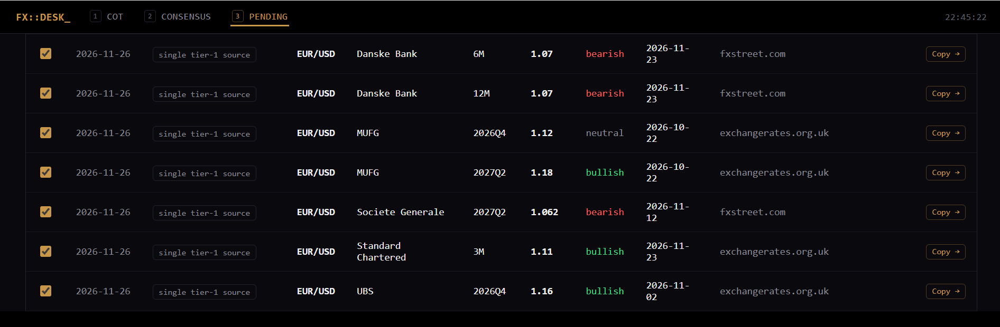

# Bank forecast collector & FX desk

Finds published sell-side FX forecasts, extracts the numbers with an LLM
under strict validation, and stages them for manual review in an offline,
single-file desk. Python (standard library + a few packages), vanilla
JS/SVG, no backend.

What makes it more than a scraper:

- **Source allowlist** - nothing off the list is ever fetched.
- **No forecast without evidence** - the model must return the verbatim
  sentence a number came from; the model's own knowledge is forbidden.
- **Sanity bands and cross-checks** - misread decimals and inverted quotes
  are caught; every row gets a trust status.
- **Human in the loop** - the script only writes to a `pending` sheet; you
  approve rows by hand.



*The Pending tab: each staged forecast carries a trust status and is
approved manually.*

A personal tool, two halves:

- **`collect.py`** finds published sell-side FX forecasts, extracts the
  numbers, and appends them to a `pending` sheet in `consensus.xlsx` — a
  running weekly log, not a snapshot. You read the evidence and approve
  rows into `forecasts` by hand; the script never writes there itself.
- **`fx-consensus-desk.html`** is a standalone, offline-first viewer —
  three tabs (COT positioning, bank consensus, pending review) plus a
  per-pair detail view with a target ladder and a forecast-distribution
  chart. No backend beyond a one-line local file server.

## Stack

- **`collect.py`**: Python standard library plus `requests`, `pyyaml`,
  `trafilatura` (HTML → clean text + publish date), `openpyxl`. No build
  step — the whole pipeline is one script.
- **`fx-consensus-desk.html`**: a single static HTML file. Vanilla
  JS/CSS + hand-rolled inline SVG for every chart (sparklines, the weekly
  consensus-mix bars, the forecast-distribution histogram, the target
  ladder) — no charting library. The one external dependency is
  [SheetJS](https://sheetjs.com) (`xlsx.full.min.js`, loaded from
  cdnjs) to parse `.xlsx` files client-side. Nothing is fetched or sent
  anywhere else; both workbooks stay on your machine.
- **`open-desk.bat`**: starts `python -m http.server` in the project
  folder so the desk can `fetch()` both workbooks itself instead of
  asking you to pick a file every time, then opens the browser a beat
  later so it doesn't race the server starting up.
- Search: [Brave Search API](https://brave.com/search/api) (free tier,
  2,000 queries/mo). Extraction: Claude (`claude-haiku-4-5`, set in
  `sources.yaml`) — cheap enough that a full weekly pass costs cents,
  with `sane()`/`cross_check()` catching the extraction misses a smaller
  model makes more often than a larger one.

## Setup

```bash
pip install -r requirements.txt

export BRAVE_API_KEY=...        # brave.com/search/api — free tier is 2,000/mo
export ANTHROPIC_API_KEY=...    # console.anthropic.com
```

On Windows, set them once with `setx BRAVE_API_KEY "..."` and
`setx ANTHROPIC_API_KEY "..."` (then open a new terminal), and use
`run.bat`. **Never paste keys into a file inside the project.** The
Anthropic key is billed per token and needs its own credit balance at
console.anthropic.com, unrelated to any Claude.ai subscription.

The workbooks are not included: `consensus.xlsx` is created on the first
run, and the COT file (`cot_normal_table_2022_2026_updated.xlsx`) is your
own table built from the CFTC Traders in Financial Futures reports. Without
it the desk falls back to a manual file picker.

## Run

```bash
python collect.py --workbook consensus.xlsx

python collect.py --bank Rabobank --dry-run    # one desk, writes nothing
python collect.py --bank ING --bank Nordea     # a couple of desks
python collect.py --no-cache                   # ignore cached pages
```

A full pass over all 22 desks is about 66 searches and 40–70 page reads.
Well inside the free search tier if you run it weekly; the extraction
costs well under a dollar per pass.

## What comes out

The `pending` sheet gains one row per newly staged forecast, stamped with
today's date in a `collected` column:

| column | |
|---|---|
| collected | the date *this run* found it — not the article's own date |
| status | how much to trust it, see below |
| source | the page it came from |
| seen on | every domain that carried the same number |
| evidence | the sentence the number was taken from |

Statuses, best first:

- **primary source** — the bank's own publication.
- **confirmed by N domains** — the same number on independent sites.
- **single tier-1 source** — one outlet quoting the note. Usually fine.
- **quarantine — weak source** — one low-grade site. Verify before using.

`pending` is never wiped — each run appends, so you can watch a bank's
view move week to week instead of only ever seeing the latest read. The
only dedupe is against the exact same call (bank, pair, horizon, target)
already recorded in the current ISO week, so rerunning the same day
doesn't spam duplicates.

Read the evidence column. If the sentence does not plainly state that
number for that bank and that horizon, ignore the row. That check takes a
few seconds each and is the whole reason the column exists.

## Approving into `forecasts`

Still entirely manual — on purpose. Open the desk (below), go to
**Pending**, read the evidence, then either:

- click **Copy →** on a row, or tick a few rows and click
  **Copy N selected →**

— and paste directly into the first empty row of the `forecasts` sheet
in Excel. The clipboard payload is already tab-separated in the columns
`forecasts` expects (bank, date, pair, horizon, target, bias, note), so
Excel splits it into cells on paste — no retyping, no misaligned
columns. Anything already in `forecasts` is skipped as a candidate on
the next `collect.py` run, so re-running is always safe.

## The desk (`fx-consensus-desk.html`)

Double-click **`open-desk.bat`** (keep its console window open — closing
it stops the server) rather than the `.html` file directly, so both
workbooks auto-load and re-sync whenever you switch back to the tab.
Opening the `.html` file on its own still works, just falls back to a
manual file picker.

**`[1] COT`** — reads `cot_normal_table_2022_2026_updated.xlsx` (your
own, separately maintained CFTC file — the desk never touches it,
never guesses). One card per instrument: net position, week-over-week
change, a 52-week sparkline, open interest, and — where a matching
forecast desk exists — a link straight into that pair's detail view.

**`[2] CONSENSUS`** — the approved `forecasts` sheet as a dense,
sortable, filterable table. Click any pair to open its detail view.

**`[3] PENDING`** — the full weekly log with `THIS WEEK`/`ALL HISTORY`,
pair, and status filters, a search box, and the copy-to-clipboard
approve flow above. Click a row to expand its evidence sentence and
source link.

**Pair detail** (click a pair anywhere, or a COT card's "bank consensus"
link) —

- consensus mix (bullish/neutral/bearish) and target range for the
  current snapshot
- median target by horizon
- a weekly consensus-mix chart once `pending` has 2+ dated weeks for
  that pair
- **forecast distribution**: pick a horizon from the table on the left,
  see a histogram of where bank targets cluster on the right
- **target ladder**: every bank's latest call for that pair, laid out
  on a shared price axis and colored by bias, with a median marker —
  deliberately *not* referenced against a live price, since this
  project has no live market-data source and won't fabricate one

## Tuning

Everything lives in `sources.yaml`.

**allowlist** is the setting that decides output quality. Weight 3 is the
bank itself, 2 is journalism that quotes notes verbatim, 1 needs a second
domain to be believed. Nothing off the list is ever fetched. If a pass
returns junk, tighten this before touching anything else.

**instruments** doubles as the validation bands. A number outside its band
is an extraction error, so keep them wide enough for a genuine outlier and
tight enough to catch a misread decimal.

**horizons** is a closed list. A forecast that does not map onto one of
these is dropped rather than guessed at — widen the list rather than
loosening the rule.

**max_age_days** guards against stale republishing. Search engines rank on
authority, not freshness, so an article from January will outrank a note
from last week. Pages with no detectable publish date are skipped entirely.

**settings.model** picks the extraction model. `claude-haiku-4-5` is the
default — cheap and, with the sanity/cross-check layer as a backstop,
reliable enough for this bounded a task. Swap in a larger model if you
start seeing more than the occasional "model did not return valid JSON"
skip in the output.

## Where it falls short

Goldman, Morgan Stanley and the other American bulge-bracket desks publish
almost nothing openly; you will catch them only when a journalist quotes
them. Expect good coverage of the European, Nordic, Canadian and Australian
banks, thin coverage of the US ones, and thinnest of all on the commodity
desks. Twelve to eighteen desks with a current view is a realistic steady
state, and that is plenty for a stable median.

The model is instructed to ignore its own knowledge and return nothing when
a text has no number in it. That holds up well, but it is the failure mode
to watch for: if a row's evidence sentence reads like a summary rather than
a quote, do not trust the row.

The desk has no live FX price or options-implied-volatility feed. The
target ladder and distribution charts show where banks' own targets sit
relative to each other, not relative to spot — there is no "return
potential" or "days to target" figure anywhere, because that would mean
inventing a market price this project doesn't have.

## Tests

The validation logic is covered by offline unit tests (no network, no API
keys):

```bash
python -m unittest discover -s tests -v
```

## Legal

For personal use. The numbers are facts and facts are not copyrightable,
but the articles they sit in are, and in the EU a database itself carries
protection separate from its contents. Keep it to your own workbook. If you
ever want to publish the aggregate, that is a different question and needs
each source's terms read individually.
